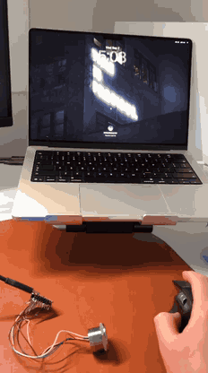

# DeskID

DeskID is an ESP32-S3 USB CCID device. It exposes a minimal PIV application and releases a private-key signature only after an R503 fingerprint match.

An ESP32-S3 with an R503 does not give the assurance of Apple's Secure Enclave. Read [Security limits](#security-limits) before deploying it.

## Demo



The clip shows a locked Mac unlocking on one touch, in real time, on the first hand-soldered prototype. [Full clip](docs/media/unlock-demo.mp4). [The bench it was built on](docs/media/bench.mp4).

[What macOS allows a fingerprint token to replace](docs/TOUCH-ID-PARITY.md)

## What is implemented

- Native ESP-IDF/TinyUSB CCID transport for the ESP32-S3 USB-OTG peripheral.
- The mandatory CCID power, status, parameter, transfer, abort, clock and data-rate paths.
- PIV application selection, Discovery, CCC, CHUID, certificate object `5FC105`, response chaining, `VERIFY`, and ECC P-256 `GENERAL AUTHENTICATE` for slot `9A`.
- Slot `9D` key management in the firmware: its own key, certificate object `5FC10B`, and ECDH through `GENERAL AUTHENTICATE`, behind the same fingerprint gate. `tools/provision.py --key-management` adds the key and certificate to a provisioned board.
- Host-driven authentication. macOS sends an APDU, CCID reports time extensions while the R503 waits, and a matching fingerprint releases the signature. The device sends no unsolicited APDU.
- Touch first. The sensor is scanned between requests. A match is held for 30 s and can be spent once, by `VERIFY` or `GENERAL AUTHENTICATE`. See [Touch first](#touch-first).
- Touch only, on development builds. A host arms the board, and after the next match the board types the PIN digits and Return itself over USB HID. See [Touch only](#touch-only).
- A P-256 key and a matching X.509 certificate in NVS. The identity comes from a host image or is generated on the device (`GENERATE ASYMMETRIC KEY PAIR` `0x47` and `PUT DATA` `0xDB`).
- ECDSA with a hedged nonce. See [Signature nonce](#signature-nonce).
- A diagnostic channel over PC/SC, because this board has no serial console: a status object at `GET DATA 5FFF01`, and `80 F0 00 00 00` to reboot into ROM download mode without a BOOT press. On this board `80 F0` lands in USB-OTG DFU. See [Entering download mode](#entering-download-mode).
- R503 packet validation, timeouts, password rotation and security level `3`, the R503 default. Enrollment runs over the card channel (`80 E1 00 00 00`) because a soldered sensor has no other host.
- Development and production firmware profiles, and host-side APDU tests.

The ring says what the board wants:

| Ring | Meaning |
|---|---|
| dark | idle; the sensor still scans |
| white, breathing | a request waits for a touch |
| blue | contact, the image is being read |
| green, 0.7 s | match |
| red, flashing | the touch was rejected |
| yellow, flashing | no usable image: lift and lie flatter |
| red, breathing | locked out; shown while a finger rests on the ring |
| purple, breathing | enrollment: place the finger |
| purple | enrollment: lift the finger |
| green, flashing | enrollment: template stored |

R503 units without a green LED have red, blue and purple only. A look the sensor refuses is sent again less its green, so white becomes purple and yellow red, and green itself becomes blue. The looks are `kRingLooks` in `src/main.cpp`.

## Hardware

The target is an [ESP32-S3 Super Mini](https://iotcrazy.com/docs/esp32-s3-m.html) board (`ESP32-S3FH4R2`, 4 MB flash, 22.5 × 18 mm), selected in PlatformIO as `lolin_s3_mini`. PSRAM is present and unused: credentials and USB buffers stay in internal RAM. The firmware switches the WS2812 RGB LED on GPIO 48 off at power-up and holds the pin low. The board's battery LED, next to the `BAT` mark, belongs to the charger and has no GPIO: on the bench board it blinks blue with no cell on `B+`/`B-`, and firmware cannot switch it off. The R503 provides its own LEDs.

### Fingerprint sensor wiring

The R503 ships with an MX1.0-6P pigtail. Pin 1 is the red wire. Wire by the printed labels. Each pad in the table is labelled except the two UART pads.

| R503 pin | Wire | R503 signal | Board pad | GPIO | Direction |
|---|---|---|---|---|---|
| 1 | red | `VIN` 3.3 V | pad marked `3V3` | n/a | Board to sensor |
| 2 | black | `GND` | pad marked `GND` | n/a | Ground |
| 3 | yellow | `TXD` | upper unlabelled left pad | `GPIO43` | Sensor to ESP32 |
| 4 | green | `RXD` | lower unlabelled left pad | `GPIO44` | ESP32 to sensor |
| 5 | blue | `WAKEUP` | pad marked `4` | `GPIO4` | Sensor to ESP32, low while touched |
| 6 | white | `3.3VT` | pad marked `3V3` | n/a | Touch-sense supply, ~5 µA |

Both edges as printed, USB-C at the top and the module facing you:

```
        left edge                          right edge

   48    RGB LED, leave alone         BAT   battery, leave alone
   ──    ◀── yellow  TXD  GPIO43       5V   never use this
   ──    ──▶ green   RXD  GPIO44      GND   ◀── black  GND
    1                                 3V3   ◀── red VIN + white 3.3VT
    2                                  13
    3                                  12
    4    ◀── blue    WAKEUP  GPIO4     11
    5                                  10
    6                                   9
    7                                   8
```

Two wiring mistakes have happened on this bench.

Each edge starts with a pad outside the numbered row: `48` (the RGB LED) top left and `BAT` top right, beside the USB-C connector. Counting them as pad 1 shifts each wire by one. Yellow lands on the LED pad and blue on `3`. On the right edge red lands on `GND` and black on `5V`, which is reverse polarity at 5 V and can destroy the sensor. Blue belongs on the pad marked `4`. The two UART pads are the unlabelled ones between `48` and `1`.

The two UART pads carry contradictory silkscreens. The front reads `RX` next to both, the back reads `TX` then `RX`, and the vendor [pinout](https://iotcrazy.com/docs/esp32-s3-m.html) shows the upper one as `U0TXD` = `GPIO43` and the lower as `U0RXD` = `GPIO44`. Sensor `TXD` goes to the upper pad and sensor `RXD` to the lower one. A reversed pair still works: `R503Sensor::initialize` retries once with the pins swapped at reduced drive strength.

DeskID runs the sensor on `UART_NUM_1` at 57600 baud, 8N1, no flow control, with `GPIO44` as its transmitter and `GPIO43` as its receiver.

Solder the blue wire. `GPIO4` is an input with the internal pull-up enabled. The R503 holds `WAKEUP` high while the ring is empty and drives it low for as long as a finger rests there, on about 5 µA of touch-sense supply. Measured on 2026-11-13 at ten samples a second: `driven high` at rest, `driven low` through two touches of 2.4 s and 3.7 s. Earlier firmware read the line the other way round and took an empty ring for a finger. A sensor with the opposite sense builds with `-DDESKID_WAKE_TOUCHED_LEVEL=1`. During an authentication the wire saves one UART round trip per poll: `GenImg` answers `0x02` when the ring is untouched, so `R503Sensor::fingerPresent` can fall back to a UART probe. Between authentications [Touch first](#touch-first) has to watch the ring all the time, and `GenImg` is a full image capture that powers the imaging array and the illumination LED. Four captures a second browned the 3V3 rail out, power-cycled the board and left the sensor unauthenticated (measured 2026-09-02). The idle scan therefore watches `WAKEUP` alone.

Without the blue wire the card still enrolls and signs. The ring stays dark until the host selects the card or sends a request.

Do not power the sensor from `5V`. `VIN` and `3.3VT` both take 3.3 V, and `3.3VT` must stay powered for finger detection.

Native USB uses the board USB-C connector (`GPIO19` D- and `GPIO20` D+). UART logging is disabled because `GPIO43` and `GPIO44` belong to the fingerprint sensor.

If the sensor answers on neither orientation the firmware still starts and USB still enumerates. `GET DATA 5FFF01` then reports `sensor: error` and each match fails closed. USB stays up because it is the only diagnostic channel on a board with no serial console.

Fingerprints are enrolled through DeskID; see [Enroll a fingerprint](#enroll-a-fingerprint). The first successful boot of a sensor build changes the module's factory password from `00000000` to the one stored in NVS and records that in NVS. An external tool needs the new password afterwards.

### Entering download mode

Two tact switches flank the USB-C connector: BOOT on the `GP1`/`GP2` side and RESET on the `3V3`/`GP13` side, with the module and RGB LED facing you. Seen from the underside they are mirrored. They need a fingernail or a pen tip.

Use the vendor's one-button entry. Unplug, hold BOOT, plug the cable in directly (a hub makes replug timing unreliable), and keep holding for about three seconds. `/dev/cu.usbmodem*` appears and `pio run -e deskid-bringup -t upload` works. Holding RESET instead removes the device from USB while held.

The board has no auto-reset transistors, so `Hard resetting via RTS pin` at the end of a flash does nothing. Unplug and replug to start the new firmware.

`80 F0 00 00 00` reboots into download mode without a button. The ROM comes up in USB-OTG DFU (`303A:0009`), because TinyUSB leaves the shared FSLS PHY mapped to the OTG wrap and that RTC-domain selection survives `esp_restart()`. `esptool` cannot see a DFU device, so the BOOT hold above remains the reflash path.

## Build and test without hardware

```bash
pio test -e native
pio run -e deskid
```

The native suite runs without the board or sensor. It covers PIV selection, public card objects, certificate response chaining, malformed APDUs, VERIFY state, user-presence deferral, `GENERAL AUTHENTICATE`, the rate limiter and the attempt ledger.

### Visual simulator

```bash
open tools/simulator.html
```

Start an authentication request, then choose Match fingerprint, No match, or Cancel request. The simulator mirrors the firmware's CCID time extensions, retry behavior, R503 LED states and `GENERAL AUTHENTICATE` response. It does not call macOS authentication APIs or emulate a smart-card reader.

`deskid` is the reversible development target. It uses the temporary TinyUSB development identifiers `CAFE:D15D` and does not enable flash encryption. The production target rejects those identifiers.

## Provision an identity

Install the pinned host tooling inside the ignored build directory:

```bash
python3 -m venv .pio/provisioning-venv
.pio/provisioning-venv/bin/pip install -r tools/requirements-provisioning.txt
```

The certificate must:

- use a P-256 public key matching the private key;
- be currently valid;
- allow `digitalSignature` in Key Usage;
- contain `clientAuth` or the Microsoft smart-card-logon OID `1.3.6.1.4.1.311.20.2.2` in Extended Key Usage.

For a disposable test identity with OpenSSL 3:

```bash
openssl ecparam -name prime256v1 -genkey -noout -out deskid-test.key
chmod 600 deskid-test.key
openssl req -new -x509 -sha256 -days 825 \
  -key deskid-test.key -out deskid-test.crt \
  -subj "/CN=DeskID Test" \
  -addext "keyUsage=critical,digitalSignature" \
  -addext "extendedKeyUsage=clientAuth,1.3.6.1.4.1.311.20.2.2"
```

For production use a CA-issued leaf and a protected manufacturing environment. Do not commit the generated key or NVS images.

### Development image

```bash
.pio/provisioning-venv/bin/python tools/provision.py \
  --development \
  --certificate deskid-test.crt \
  --private-key deskid-test.key \
  --sensor-password A1B2C3D4
```

This writes `.pio/provisioning/credentials.bin` in plaintext for bring-up. The script validates the identity, requires private-key mode `0600`, rejects the R503 factory password, refuses to overwrite existing output and deletes temporary DER files.

### On-device key generation

The development image leaves a copy of the device key on the provisioning host. The board can generate its own key instead, and the host issues a certificate for the public half:

```bash
.pio/provisioning-venv/bin/python tools/provision.py --on-device --create-ca
.pio/provisioning-venv/bin/python tools/provision.py --on-device \
  --ca-certificate .pio/provisioning/deskid-ca.crt \
  --ca-key .pio/provisioning/deskid-ca.key \
  --common-name "DeskID 001"
```

The script sends `GENERATE ASYMMETRIC KEY PAIR` for slot `9A`, signs the returned P-256 point with the host CA, stores the certificate with `PUT DATA` and reads it back byte for byte. The board then signs a random challenge, and the script verifies that signature against the issued certificate. The script writes the certificate to disk and nothing else. The CA signing key stays on the host. The device key exists on the board alone.

A board that has its identity gets the key management key the same way, without touching slot `9A`, so a paired Mac stays paired:

```bash
.pio/provisioning-venv/bin/python tools/provision.py --key-management \
  --ca-certificate .pio/provisioning/deskid-ca.crt \
  --ca-key .pio/provisioning/deskid-ca.key
```

The authority has to be the one that issued the identity certificate; the script checks that signature first. It then generates the key in slot `9D`, issues a certificate whose only key usage is key agreement, stores it as `5FC10B`, and agrees a key with a random peer to prove the private half is on the board. On a provisioned board each of the three steps waits for a fingerprint. macOS wraps the login keychain password to this key when the card is paired; without it macOS asks for that password at every smart card unlock.

The board still needs an NVS image for the R503 password, so the development image remains the first step. All three APDUs are user-presence gated, so a sensor build waits for a fingerprint at each one.

Build, put the board in [download mode](#entering-download-mode), and flash all images in one session:

```bash
pio run -e deskid
~/.platformio/packages/tool-esptoolpy/esptool.py \
  --chip esp32s3 --port /dev/cu.usbmodemXXXX write_flash \
  0x0000 .pio/build/deskid/bootloader.bin \
  0x8000 .pio/build/deskid/partitions.bin \
  0x9000 .pio/provisioning/credentials.bin \
  0x10000 .pio/build/deskid/ota_data_initial.bin \
  0x20000 .pio/build/deskid/firmware.bin
```

### Enroll a fingerprint

A soldered R503 has no UART left for an external enrollment tool, so DeskID enrolls over the card channel:

```bash
python3 tools/hw_smoke_test.py --enroll
```

A finger is recorded as placements, one image and one template each. `--enroll` asks for 12 (`--placements`) and says how to lay the finger for each, because the sensor sees a part of the finger at a time and the placements have to cover how it lands in daily use. With an empty library the first placement needs no match. With fingers already enrolled the tool first waits for one of them: the ring breathes white, an enrolled finger matches, and that match opens enrollment for 60 s. Each stored placement renews the 60 s, up to 12 on one match (`kEnrollmentSessionMilliseconds`, `kEnrollmentSessionTemplates`). The finger has to lift between placements, and an image is taken after it has rested for 0.3 s. The ring breathes purple for "place", turns solid purple for "lift" and flashes green when a placement is stored. The idle scan pauses for the session, so the new finger is not matched and costs no attempts.

Each `80 E1 00 00 00` performs one step of the R503 sequence and returns at once, so the CCID channel does not stay open while a person moves a finger. The tool prints each stage change and reports success once the template count in the status object has gone up.

While the library is empty, enrollment needs no authorization. An empty sensor cannot produce a match, so a gate would make the first finger impossible to enroll. Empty means the sensor has reported zero templates. A count the sensor has not reported is treated as a full library. Once one template exists, `80 E1` starts with a match by an enrolled finger: a new finger requires an existing one. Earlier firmware asked for that match at every step and took each image from the touch that had just matched, so the only thing it could add was a finger the sensor already knew, lying where it already knew it. `80 E2` empties the library and needs a match too.

The sensor window is smaller than a fingertip, and a finger that lands on another part of its pad than the one enrolled is rejected. On 2026-11-13 four calm touches of two seconds matched, and thirteen hurried ones at real prompts did not. Enroll the same finger several times, lying the ways it lands in a hurry.

Press flat and hold for a second. A held finger gets three match attempts and six capture attempts before the firmware asks for it to lift (`kRetriesPerTouch` in `src/main.cpp`). A red flash means the finger has used its attempts: lift and try again. A rejected touch counts once toward the five-failure lockout, however many of its images were rejected. If the status object shows `consecutive failed matches: 0` after a timeout, no image passed quality and no match was attempted. Press flatter.

### Production image

Run `tools/provision.py` without `--development`. It produces:

- `.pio/provisioning/credentials.bin`, encrypted with NVS XTS-AES;
- `.pio/provisioning/keys/nvs_keys.bin`, the matching 4 KB NVS key partition.

The `deskid-production` target enables release-mode flash encryption and encrypted NVS. It refuses to compile until `platformio.ini` contains a VID/PID assigned to this product.

Before a production flash:

1. Obtain an authorized USB VID/PID. Do not impersonate another product.
2. Configure Secure Boot V2 and an offline signing key in `sdkconfig.production.defaults`. The runtime refuses to sign when Secure Boot or flash encryption is absent.
3. Define and rehearse the eFuse plan on expendable boards: Secure Boot, flash encryption, anti-rollback, JTAG and ROM-download policy.
4. Back up the signing and NVS keys under separate access control.
5. Flash `credentials.bin` at `0x9000` and `nvs_keys.bin` at `0xF000` in the same session as the signed firmware, before the first release-mode boot.
6. Verify the release image on macOS, Windows `usbccid.sys` and Linux `pcscd/libccid` before burning final lock bits.

Release flash encryption and eFuse operations are irreversible. Follow Espressif's current [Security Features Enablement Workflows](https://docs.espressif.com/projects/esp-idf/en/stable/esp32s3/security/security-features-enablement-workflows.html). Commands copied from an older SDK may no longer apply.

## macOS integration

### Touch first

macOS draws its own PIN field for a smart card at the lock screen and in `pam_smartcard`, and [no published setting removes it](#pin-prompt). DeskID cannot replace that field. It removes the waiting around it. The earlier sequence was: click the PIN field, type six digits, submit, watch the ring start breathing, reach for it, wait for the match.

The firmware now scans the sensor between host requests. A match is kept for 30 s and spent by the next login instruction:

1. Touch the sensor as you sit down. The ring turns solid blue on contact, matches in about 0.8 s and shows green.
2. Type any digits and press Return.
3. The card answers without waiting. Status tag `0x0E` reports that an earlier touch answered, and `0x11` counts those answers.

Measured at the lock screen on 2026-09-02, on a `deskid` board with an R503: an idle match took 749 ms from finger-on to confirmed, and `GENERAL AUTHENTICATE` returned in 0.2 s. The same request without an earlier touch ran 30 s of CCID time extensions.

Without an earlier touch the ring starts breathing when the request arrives and waits up to 30 s for a finger.

Three rules bound the window:

- Single use. Spending the touch clears it whether or not the signature that follows succeeds.
- Login only. `VERIFY` and `GENERAL AUTHENTICATE` may spend it. Enrolling a finger, writing a key or certificate, emptying the sensor and rebooting into download mode each need a live match while the host waits. `deskid::EarlyTouch::maySpend` enforces this and `test/test_piv` tests it.
- 30 s, the time a request waits for a finger. A first value of 15 s covered a deliberate touch, click, digits and Return, and failed at a normal pace. The constant is `kEarlyTouchValidMilliseconds` in `src/main.cpp`, and `Device.earlyTouchWindow` in the setup app must match it.

A rejected idle touch costs one rate-limiter attempt. The ring then stops looking until the finger lifts, so an object resting on the sensor cannot run the device into a lockout.

The idle scan needs the blue wire. `WAKEUP` on `GPIO4` makes each idle poll a GPIO read at about 5 µA, and the firmware answers contact within 40 ms. The UART fallback is `GenImg`, and running it without a limit power-cycles the board (see [Fingerprint sensor wiring](#fingerprint-sensor-wiring)). Without a usable wake line the board scans with `GenImg` inside a bounded window: 20 s after the host selects the card, or up to 120 s after `80 E3`. `hw_smoke_test.py --status` reports `wake line (GPIO4)`: `high` with the ring empty and `low` under a finger means the wire is good. Measured on 2026-11-13 with the line read the right way round: four touches given with no host request matched in 869 to 967 ms, and a 0.1 s tap cost no attempt.

### Touch only

A development build can type the PIN for you. macOS still draws its PIN field, and the board fills it: after a fingerprint match it types six keypad digits and Return over USB HID, and the login instruction that follows spends that same match. The digits are a constant and unlock nothing. The applet ignores the PIN value and signs only after a match.

The board presents three USB interfaces: the CCID reader, a keyboard, and a vendor HID interface for arming. It cannot see the screen, so a host tells it when a PIN field has the keyboard:

```bash
swift tools/deskid_arm.swift 10   # arm for 10 s, then touch the ring
```

Arming is a feature report on the vendor interface (usage page `0xFF00`, usage `1`, no report ID): `01`, then the seconds. `02`, then the seconds, is the same request for a display that is asleep. Reading the report back returns `01`, the seconds the arming has left, the number of emissions since power-up and a status byte. Bit 0 of the status is set when the board understands `02`. Bit 1 is set when the wake line is trusted, so watching the ring costs no image captures and a host may keep the board armed.

Four rules bound it:

- Armed only. A match types nothing unless a host armed the board in the last 15 s (`kMaximumAutotypeSeconds`).
- Single use. One arming types once, and zero seconds disarms.
- A match is still required, from a touch that lands while the board is armed. A touch given earlier is never typed for, so one left behind cannot unlock a screen that locked after it.
- Development builds only. `DESKID_ALLOW_AUTOTYPE` is set for `env:deskid`. Arming carries no authentication yet, so any local process can ask the board to type its constant after your next touch. A production image ignores the request.

Each key is down for 30 ms and up for 30 ms (`kAutotypeReportMilliseconds`), about 0.4 s for the seven keys. `deskid::Autotype` holds the policy and `test/test_piv` tests it.

Keys sent into a dark lock screen are lost. Armed with `02`, a match taps Left Shift and types nothing. The display wakes, the host sees a lit screen that is still locked and arms with `01`, and that arming types the digits 400 ms later (`kAutotypeLitMilliseconds`). The match waits 10 s for it (`kWokenMatchMilliseconds`). Zero seconds drops the match, so a Mac that something else unlocked in between gets no digits.

macOS drops keys while a display comes up and reports nothing. Measured on 2026-11-13 on macOS 27.0.1 with an external monitor: the wake tap lit the display, digits typed 0.6 s to 1.0 s after it were lost, and the display took keys 2.0 s after the tap. So the digits are typed again every 2.2 s (`kRetypeMilliseconds`), at most twice (`kMaximumRetypes`), until the host asks the card for a private-key operation, which only a submitted PIN field causes.

A Mac that is fully asleep suspends the bus and runs no helper, so nothing arms the board. A match then signals remote wakeup, taps Left Shift once the bus resumes, and is held for the `01` arming the same way. The configuration descriptor sets the remote wakeup bit for this. A board whose wake line is not trusted does not watch its ring while the Mac sleeps and cannot wake it.

What to expect from macOS:

- Keyboard Setup Assistant can open the first time macOS meets a keyboard it does not recognise. Close it if it does.
- With Mouse Keys on, the keypad moves the pointer and no digits arrive.
- A locked Apple silicon laptop can hold back a keyboard it has not approved. The setting is "Allow accessories to connect" in Privacy & Security.

Measured on 2026-11-13 on macOS 27.0.1, on a `deskid` board with an R503:

- Armed, with a text editor in front: one touch typed `123456` and Return, 955 ms after contact.
- Armed, with an administrator prompt in front: one touch authorized it. The prompt closed within 3 s of contact and the status object reported `answered by an earlier touch`.
- Not armed: a touch matched and typed nothing.
- The arming interface opened from a shell with no Input Monitoring request, and Keyboard Setup Assistant did not open.

- At the lock screen, with the card paired and a host process arming the board while the screen was locked and lit: one touch unlocked the Mac. The signature took 220 ms and the key agreement that followed took 201 ms.

Not run yet: `sudo`, an unenrolled finger while armed, the `02` request on a sleeping display, and waking a Mac that is asleep. This repository has no helper that arms the board on its own, so `tools/deskid_arm.swift` is the trigger.

### Guided setup

```bash
tools/deskid-setup
```

The setup app has five steps: connect, enroll a finger, ask for one signature, pair the card with your login, finish. It talks to the board through CryptoTokenKit, the stack `loginwindow` uses, and pairs through `sc_auth`. Once built it needs neither Python nor this repository. It sends the same APDUs as `tools/hw_smoke_test.py`, and `tools/deskid-setup --check` tests the parsing against a status object recorded from a board.

The app guards against four mistakes:

- Missing the touch during pairing. `sc_auth pair` makes the card prove it holds the private key, which needs a fingerprint match inside the 30 s window. Without one `sc_auth` reports `6982` and does not mention a finger. The app says so before you click and shows the ring waiting.
- Pairing a `deskid-bringup` image, which approves each presence request with no sensor attached. The app reads the build variant and refuses.
- Signing in before the sensor can match. The app offers the signature test and pairing only after a template is enrolled.
- Getting locked out. The last screen lists the daily steps: any 6 to 8 digits at the PIN field, touch, and unplug to get password login back. Unpair is on the pairing screen while the card is paired and needs no admin password.

The launcher compiles `tools/deskid_setup.swift` into `dist/DeskID Setup.app` on first run, in about half a minute, and ad-hoc signs it with the `com.apple.security.smartcard` entitlement. CryptoTokenKit gives a process without that entitlement no slots, so the app is a bundle. It needs no Xcode project and no developer account. `tools/deskid-setup --build` builds without launching. The app runs on macOS 14 or later and can be copied to another Mac.

Measured on the bench, 2026-09-01: the app read `5FFF01` over CryptoTokenKit, drove `80 E1` with an enrolled finger present, and showed the board's `6982` refusal with the tap-and-lift advice.

### DeskID token driver

Apple's built-in `com.apple.CryptoTokenKit.pivtoken` claims any card that answers the PIV AID and requires a PIN for slot `9A`. On that driver the user types six digits and then touches the ring ([measured](#pin-prompt)). DeskID ships its own CryptoTokenKit smart-card token, `tools/deskid_token.swift`, built into `DeskID Setup.app` as `Contents/PlugIns/DeskIDToken.appex`:

- The board answers a private AID, `F0 "DeskID"` (`F0 44 65 73 6B 49 44`), so Apple's driver does not claim the card. The board serves the standard PIV AID only when `DESKID_ALLOW_PIV_AID` is set. `deskid-bringup` sets it, for hosts without the DeskID driver.
- The token publishes the certificate and one signing key with constraint `true`, which macOS reads as always allowed. The token defines no PIN, so macOS draws no PIN field.
- Each `sign` request becomes `GENERAL AUTHENTICATE` on the board and blocks until the fingerprint gate answers. The extension holds no secret.

Install it from the setup app's pairing screen (Install DeskID Driver) or from the command line:

```bash
tools/deskid-setup --install     # copies to /Applications, registers with pluginkit
security list-smartcards         # expect dev.deskid.setup.token:… after a replug
swift tools/pin_probe.swift      # expect a signature, not -1004
```

macOS attaches drivers on card insertion, so replug after installing. Status tag `0x0D` reports finger-on to match-confirmed in milliseconds.

### Virtual CryptoTokenKit slot

Public CryptoTokenKit APIs cannot implement a software-only `TKSmartCardSlot` or `TKSmartCard` provider:

- `TKSmartCardSlotManager` discovers readers that SmartCardServices already knows about. It has no public slot-registration API.
- `TKSmartCard.makeSmartCard()` returns a client object for an existing slot. It does not publish a card.
- A `TKSmartCardTokenDriver` receives an existing physical smart card and handles high-level key operations. It does not intercept inbound APDUs.
- Smart Card Token extensions have no UI. `loginwindow`, CryptoTokenKit and PAM own authentication prompts, so an extension cannot present its own Confirm Login window.

A smart-card token extension for a physical reader is possible, and [the DeskID driver](#deskid-token-driver) is one. For that reason the board stopped answering the PIV AID: two drivers matching one card race each other.

`vsmartcard` with `ifd-vpcd` is the nearest lab workaround. Modern macOS needs a spare physical USB device to trigger loading the legacy IFD bundle, so it suits a test bench and nothing more. See the upstream [macOS notes](https://frankmorgner.github.io/vsmartcard/virtualsmartcard/README.html).

### Hardware smoke test

With a provisioned board connected, the script exercises it through the macOS PC/SC stack:

```bash
python3 tools/hw_smoke_test.py                 # identity and recovery checks
python3 tools/hw_smoke_test.py --repeat 200    # reliability and latency
python3 tools/hw_smoke_test.py --sign          # needs a fingerprint match on sensor builds
python3 tools/hw_smoke_test.py --status --enroll --sign   # first bring-up of a wired sensor
python3 tools/hw_smoke_test.py --quick --status --json    # one JSON object per line
```

`--quick` skips the identity sweep and the card power cycle, so one question costs one exchange. `--json` prints one JSON object per line for scripts.

The script has no dependencies. It reaches `PCSC.framework` through `ctypes` and calls `openssl` for the signature check. It verifies:

- the ATR and the exact `SELECT` payload;
- CCC, CHUID and certificate reads, including `61xx` chaining;
- that the CHUID GUID is the RFC 4122 form of `SHA-256(certificate)[:16]`;
- that unknown data objects and foreign AIDs are refused with `6A82`;
- that the applet survives a CCID power cycle.

`--sign` verifies a live `GENERAL AUTHENTICATE` signature against the certificate the board serves. That check proves the stored key, PSA signing and the PIV response format agree.

Recorded on a wired `deskid` board, 2026-09-01: 0 failures, 20 of 20 select plus certificate reads at 1 ms median, first fingerprint enrolled (`templates 0 -> 1`), and `--sign` returned a signature 10.1 s after a live match. The signature verified against the board's own certificate. Without a finger the same request returns `6982` after 30.2 s of CCID time extensions. The board serves the certificate it issued itself (see [On-device key generation](#on-device-key-generation)), so pass `--certificate .pio/provisioning/deskid-device.crt` in place of the default test identity.

### Diagnostics

TinyUSB owns the USB PHY and `CONFIG_ESP_CONSOLE_NONE` is set, so USB-Serial-JTAG disappears when the firmware boots. PC/SC is the one channel to a running board:

```bash
python3 tools/hw_smoke_test.py --status
```

`GET DATA 5FFF01` needs no user presence and returns no secrets. It reports:

- firmware version, build variant, uptime, `esp_reset_reason()` and free heap;
- sensor state and the last R503 confirmation byte;
- whether a credential is present;
- consecutive failed matches and remaining lockout;
- the number of fingerprint templates in the sensor;
- the level of the wake line;
- whether the signing self-test passed at power-up.

The build variant matters: a `deskid-bringup` unit approves each presence request.

The wake line field checks the blue wire. Run `--status` with the ring empty and again with a finger on it: `high` then `low` means the wire is good. A level that never changes means the idle scan in [Touch first](#touch-first) will not run, because the firmware trusts the line only after it has seen both levels. During an authentication the firmware falls back to a UART probe and loses a little latency.

The same channel reboots the board into download mode without a button press:

```bash
python3 tools/hw_smoke_test.py --download-mode   # or send 80 F0 00 00 00 yourself
```

`80 F0` is user-presence gated, so a host cannot trigger it without a touch. It is compiled out of `deskid-production`: `DESKID_ALLOW_DOWNLOAD_MODE` is set on `deskid` and `deskid-bringup`, and the production environment inherits from `[deskid_common]`, which does not carry the flag.

Measured 2026-09-01: the reboot happens and the ROM comes up in USB-OTG DFU (`303A:0009`), so `pio run -t upload` cannot follow it. [Entering download mode](#entering-download-mode) explains the cause and the BOOT hold that works.

### Signature nonce

An ECDSA signature needs a secret number used once. A repeated or biased one gives the private key to anyone who holds the signatures, so the firmware does not leave it to the random generator alone. It seeds an HMAC_DRBG with 32 fresh random bytes, the private scalar and the digest, and takes the nonce from that:

```
Z || 63 zero bytes || x || 32 zero bytes || bits2octets(h)
```

This is RFC 6979 with the input layout of `draft-irtf-cfrg-det-sigs-with-noise-05`. If the random generator fails, the nonce is still what RFC 6979 would give: secret, and different for each digest. While the generator works, two signatures of one digest differ, which plain RFC 6979 does not offer and which the differential fault attacks on it rely on. Verifiers see ordinary ECDSA.

PSA Crypto has randomized ECDSA and RFC 6979, and no way to pass a nonce source in. The firmware therefore calls `mbedtls_ecdsa_sign` from the private half of TF-PSA-Crypto 1.0, the version ESP-IDF 6.0.1 ships. A platform upgrade has to rebuild and rerun the checks below.

Three checks cover it:

- `pio test -e native` pins the seed layout, byte for byte.
- At power-up the board signs the RFC 6979 A.2.5 key and digest with a fixed `Z` and compares the result with a known answer. `--status` reports it, and a board that fails refuses to sign. `python3 tools/hedged_ecdsa_reference.py` derives that answer in the standard library and first reproduces the RFC's own vector.
- `python3 tools/hw_smoke_test.py --nonce` signs one digest twice, checks both signatures against the certificate and requires them to differ. It takes two touches.

### PIN prompt

```bash
swift tools/pin_probe.swift              # read-only, changes nothing
swift tools/pin_probe.swift --allow-ui   # same, but let the prompt appear
```

The probe asks macOS to sign with the token key while forbidding authentication UI. A signature means macOS asked for nothing before reaching the card. `LAError.notInteractive` (`-1004`) means macOS was about to ask for a PIN. Measured against Apple's stock `pivtoken` on 2026-09-01: a PIN is required. `sc_auth verifypin -t <token-id> -p 123456` then returns *PIN verified*, because the applet accepts any eight-byte PIN block once the fingerprint gate is satisfied.

Apple's built-in PIV flow displays a PIN field because PIV defines slot `9A` as PIN-protected. DeskID ignores the PIN value and requires the standard eight-byte `VERIFY` APDU plus a live R503 match, so any six to eight digits pass. Public CryptoTokenKit APIs cannot replace that prompt with a biometric dialog. The blue ring is the user-presence cue.

### Pair the DeskID token

Install and trust the issuing CA in the System keychain on a test machine. Keep a separate recovery administrator account before changing smart-card login policy. Then connect DeskID and verify in order:

```bash
pluginkit -m -p com.apple.ctk-tokens
system_profiler SPSmartCardsDataType
security list-smartcards
sc_auth identities
```

`sc_auth identities` shows the certificate from PIV slot `9A`. Pair the exact hash it reports:

```bash
sudo sc_auth pair -u "$(whoami)" -h "<identity-hash>"
sudo -k
sudo true
```

The wrapper finds the hash, runs the preflight and unwinds the pairing if a later step fails:

```bash
tools/sc_auth_gate.sh status
sudo -v                         # get the password prompt out of the way first
tools/sc_auth_gate.sh pair      # then touch the sensor when the ring lights
tools/sc_auth_gate.sh unpair    # undo; this one does not need root
```

Pairing needs a fingerprint. `sc_auth pair` asks the card to prove it holds the private key, which is a `GENERAL AUTHENTICATE` behind the presence gate. Touch the enrolled finger within 30 s, or pairing fails with `CryptoTokenKit error -3 - SmartCard returned error 6982` and changes nothing. Authenticating `sudo` first leaves the whole window for the finger. [The setup app](#guided-setup) does this sequencing.

Unplugging the token returns the login window to password entry. Check `sc_auth filevault -o status` first. If card-based FileVault is unavailable for the account, the preboot screen takes the password and pairing cannot lock you out of a boot.

Test `sudo` and logout/login recovery before enforcing smart-card-only login. Apple documents policy and recovery in [Intro to smart card integration](https://support.apple.com/guide/deployment/intro-to-smart-card-integration-depd0b888248/web).

#### Smart-card-only login

Pairing adds DeskID to the lock screen and keeps the existing options. On a MacBook the screen still offers the built-in Touch ID and the password, and the user has to pick the smart-card field. `enforceSmartCard` removes the other options ([Configure macOS for smart card-only authentication](https://support.apple.com/en-ca/guide/deployment/depfce8de48b/1/web/1.0)):

```bash
sudo defaults write /Library/Preferences/com.apple.security.smartcard enforceSmartCard -bool true
```

The setting stops all password-based authentication. Before running it, put a recovery path in place, in this order:

1. A second administrator account without a paired card, tested by logging into it.
2. `sc_auth filevault -o status`. If card-based FileVault is unavailable for the account, the preboot screen takes the password and a bad policy cannot cost a boot. Verify this.
3. `/private/etc/SmartcardLogin.plist` with a `NotEnforcedGroup` naming a group the recovery account belongs to. This undo works while locked out. `defaults delete … enforceSmartCard` needs a shell you may not have.

With enforcement on, unplugging DeskID no longer returns the Mac to password login. `allowUnmappedUsers -int 1` lets accounts with no pairing keep their passwords. It is the milder policy and the better one on a shared machine.

## Security limits

- The firmware charges a match attempt to the lockout counter, and writes it to flash, before it asks the sensor for a verdict. Cutting power does not buy another try. Rewriting an older NVS image still can, wherever flash is writable.
- R503 UART responses carry no cryptographic authentication. An attacker with physical access to the internal UART can inject a successful match.
- ESP32-S3 encrypted flash and Secure Boot harden key storage. The chip remains a general-purpose microcontroller: runtime extraction, fault injection and side channels stay possible.
- The R503 password is 32 bits. It stops accidental access and fails against a determined physical attack.
- Host provisioning leaves a copy of the private key under manufacturing control. `tools/provision.py --on-device` generates the key on the board. The NVS packaging step is still needed for the R503 password.
- `80 F0` reboots the device into ROM download mode. It requires a fingerprint match and is absent from production builds. On development builds one match is enough to replace the firmware.
- A development build types a constant PIN after a match when a host arms it ([Touch only](#touch-only)). Arming is unauthenticated: local software can make the board type that constant into the front window after your next touch. It cannot make the board sign, which still takes the match. Production builds ignore arming.
- Fingerprint templates stay inside the R503. `80 E1` enrolls without authorization while the sensor reports an empty library. Recovery from a lost finger needs a separate authenticated process, which does not exist yet.

A high-assurance commercial device needs a reviewed secure element and a sensor link with cryptographic match attestation. The ESP32-S3 and R503 alone cannot give the physical-tamper guarantees of Touch ID.

## License

DeskID is source-available under the PolyForm Strict License 1.0.0 with three additional permissions: device owners, evaluation and audit, private changes and security research. You may read, build and audit the code. Selling it, redistributing it or building a product on it needs a written license.

- Terms in plain language: [LICENSING.md](LICENSING.md)
- Binding license text: [LICENSE.md](LICENSE.md)
- Components fetched at build time: [THIRD-PARTY-NOTICES.md](THIRD-PARTY-NOTICES.md)
- Reporting a vulnerability: [SECURITY.md](SECURITY.md)
